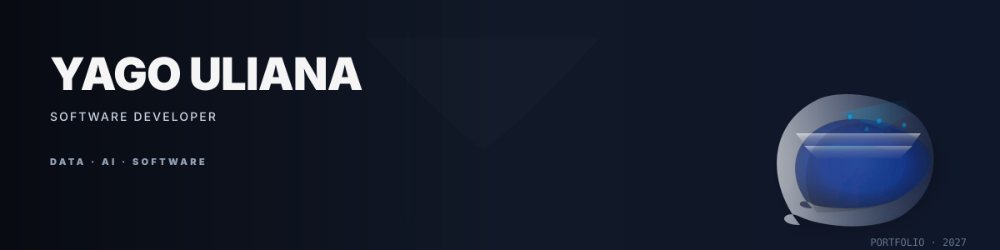

  

---

### Perfil
Desenvolvedor formado pelo SENAI-SP com foco em estruturação de sistemas e análise de dados. Meu trabalho une lógica de programação e boas práticas de engenharia, com foco atual em Ciência de Dados e Inteligência Artificial.

---

### Áreas de Interesse
* **Ciência de Dados** — Análise e processamento.
* **Inteligência Artificial** — Fundamentos e aplicação.
* **Banco de Dados** — Modelagem, estruturação e otimização.

---

### Tecnologias & Ferramentas
<table width="100%">
  <tr>
    <td width="25%"><strong>Linguagens</strong></td>
    <td width="75%">Python, PHP, JavaScript</td>
  </tr>
  <tr>
    <td width="25%"><strong>Frameworks</strong></td>
    <td width="75%">Laravel, React, Flet</td>
  </tr>
  <tr>
    <td width="25%"><strong>Dados</strong></td>
    <td width="75%">MySQL, SQLite</td>
  </tr>
  <tr>
    <td width="25%"><strong>Ferramentas</strong></td>
    <td width="75%">Git, VS Code, Figma</td>
  </tr>
</table>

---

### Projetos Selecionados

| Projeto | Descrição | Link |
| :--- | :--- | :--- |
| **Sistema Mapa Laravel** | Aplicação com API OpenStreetMap via Leaflet.js. | [Acessar](https://github.com/Yagouliana/Sistema_mapa-laravel) |
| **Password Generator** | Aplicação desktop em Python (Flet). | [Acessar](https://github.com/Yagouliana/password-generator-python) |
| **CRUD Python** | Sistema de gerenciamento com Tkinter/SQLite. | [Acessar](https://github.com/Yagouliana/CRUD-EM-Python) |
| **To-Do List React** | Web app de tarefas com foco em controle de estado. | [Acessar](https://github.com/Yagouliana/Aplicativo-de-lista-de-tarefas-To-Do-List-React) |

---

### Formação
**Técnico em Desenvolvimento de Sistemas** | SENAI-SP
**Ensino Médio** | SESI

---

### Contato
[LinkedIn](https://www.linkedin.com/in/yago-uliana-0877b4377/) | [E-mail](mailto:ulianayago2@gmail.com)
